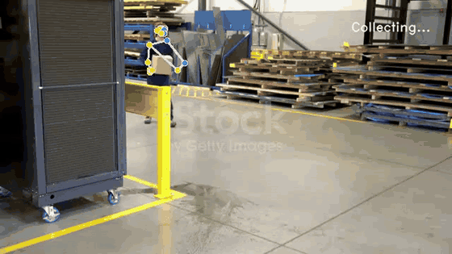
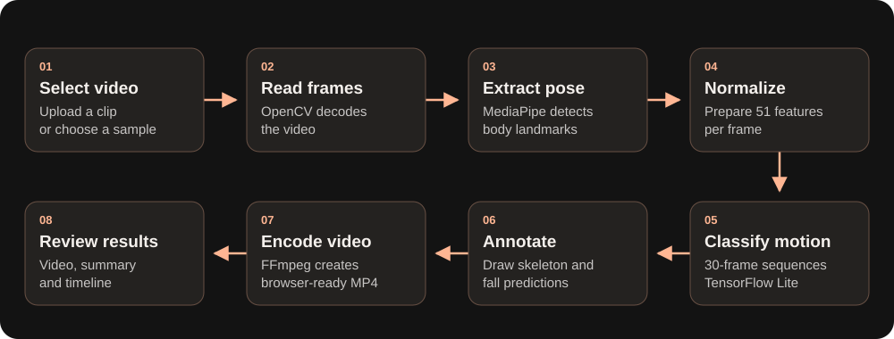

<div align="center">

<h1>Aether</h1>

### AI-powered fall detection, with evidence you can review.

From recorded movement to annotated video, predictions, and a readable timeline.

**Computer Vision · Human Pose Estimation · Temporal Deep Learning**

[The idea](#the-idea-behind-aether) · [Features](#what-you-can-do) · [How it works](#from-video-to-prediction) · [Demo](#see-aether-in-action) · [Run locally](#run-locally-windows)

</div>

---

## The idea behind Aether

A person bends down, sits quickly, or loses their balance. A single image may capture a similar posture in each case, but the movement leading to that moment tells a different story. **Aether explores how human pose and motion over time can help identify potential falls in recorded video.**

Manually reviewing footage means watching through ordinary activity to find the moments that matter. This project brings the video, model predictions, and observations into one place, making the analysis easier to demonstrate and inspect.

Upload a clip or choose a sample, start the analysis, and Aether returns a video with body landmarks and prediction overlays. A summary and timestamped timeline help you connect the reported outcome to what happened on screen.

> **The project in one sentence:** Aether combines pose estimation and sequence-based classification to turn recorded video into reviewable fall-detection results.

The current application is a working prototype for academic presentations, computer-vision demonstrations, and experimentation. It processes uploaded recordings; live monitoring and automatic emergency notifications are future extensions.

## See Aether in action

The first sample, **Warehouse Carrying Fall**, processed by Aether's actual analysis pipeline:

<p align="center">
  
</p>

**Watch the movement:** the dots mark detected body landmarks, and the connecting lines show the estimated skeleton. As the person falls, the model evaluates successive motion sequences and the video displays **FALL DETECTED!** when the fall threshold is reached.

In this run, the first fall event was reported at approximately **4.2 seconds**. The confidence shown on the video is the model's prediction score, not a measurement of overall accuracy. This is a recorded analysis result; the looping preview does not run inference in your browser.

[**Open or download the full-quality demo video (MP4)**](images/aether-analysis-demo.mp4)

## What you can do

| Feature | What it adds to the experience |
| --- | --- |
| **Upload your own video** | Choose or drag in a recording; MP4 is recommended. |
| **Try four sample scenarios** | Demonstrate fall and non-fall footage without preparing an upload. Each preview comes from its actual video. |
| **Start analysis explicitly** | Processing begins when you click **Analyze Video**; the loading indicator appears only while analysis runs. |
| **Watch annotated results** | Review the detected skeleton, frame predictions, and fall overlays alongside the original footage. |
| **Control looping playback** | The output starts muted and loops automatically, with Stop Video / Play Video controls. |
| **Inspect the outcome** | Read the detection summary and compare timestamped observations and confidence scores. |
| **Download results** | Export the available text summary for later reference. |
| **Explain the project** | Open the **ⓘ** panel for an overview during a demonstration. |

The dashboard keeps the workflow focused: **choose a video → analyze it → review the evidence**.

## From video to prediction

<p align="center">
  
</p>


### 1. Describe the body through landmarks

MediaPipe Pose estimates the person's body position. Aether selects **17 landmarks**, including the shoulders, elbows, wrists, hips, knees, and ankles. Each landmark contributes horizontal position, vertical position, and visibility, giving **51 values per frame**.

These landmarks provide a compact representation of posture that the classifier can analyze across successive frames.

### 2. Prepare comparable pose features

People can appear at different positions and sizes within a video. The application centers coordinates around the hips and scales them using the vertical shoulder-to-hip distance when suitable landmarks are available. This normalization helps represent movement relative to the body.

If no pose is detected, the frame contributes a zero-valued feature vector. Occlusion and unreliable landmarks can therefore affect the result.

### 3. Analyze movement over time

The bundled **TensorFlow Lite Transformer model** receives a sliding window of **30 frames**, each containing 51 features. Its input shape is `(1, 30, 51)`.

The window moves forward as new frames arrive, allowing the model to classify a sequence of movement. A fall probability of **0.90 or higher** produces a fall prediction. Classification begins after the first complete window; the time represented by 30 frames depends on the source video's frame rate.

### 4. Make the prediction reviewable

OpenCV draws the skeleton and prediction overlays onto the video. FFmpeg converts the output into H.264 MP4 for browser playback. The dashboard then displays the annotated result and extracts timestamped observations from the processing summary.

A **10-second cooldown** limits repeated fall-event messages. Frame-level classification continues during that interval.

## Technologies and their roles

| Layer | Technology | Why it is used |
| --- | --- | --- |
| Dashboard | HTML, JavaScript, Tailwind CSS | File selection, analysis controls, responsive layout, and playback |
| Backend | Python, FastAPI, Uvicorn | Serve the interface, accept uploads, and return results |
| Pose estimation | MediaPipe Pose | Locate body landmarks in each frame |
| Feature preparation | NumPy | Normalize landmarks and form model input arrays |
| Classification | TensorFlow Lite through TensorFlow CPU | Run the bundled motion-classification model locally |
| Video processing | OpenCV | Decode footage and draw annotations |
| Video encoding | FFmpeg | Produce browser-compatible output |
| Alternate interface | Gradio | Provide a secondary interface at `/api` |
| Research | Jupyter notebooks | Explore LSTM, bidirectional LSTM, and Transformer approaches |

**The main dashboard requires no Node.js, npm build, or dedicated GPU.** The model and sample clips are included in the repository, so you do not need to train a model before running the demonstration.

Inference runs on the machine hosting the app. In the local setup below, videos are analyzed on your computer without a hosted inference API. The interface still loads styles and fonts from external services.

## Walk through a demo

### Choose a scenario

The four sample cards offer a quick way to introduce the workflow:

| Sample | What the footage shows |
| --- | --- |
| **Warehouse Carrying Fall** | A person falling while carrying a box |
| **Gym Walking Fall** | A fall while walking beside gym equipment |
| **Fall from a Chair** | A seated fall in a gym |
| **Indoor Walking · No Fall** | Walking and turning indoors without a fall |

These names describe the footage, not guaranteed predictions. You can also upload a short MP4 of your own.

### Run the analysis

Click **Analyze Video** and wait for processing to finish. The output starts playing automatically and repeats so you can discuss the movement and overlays. **Stop Video** pauses playback and returns it to the beginning; **Play Video** starts it again.

### Explain the result

Use the annotated footage to show the body landmarks and predictions. Then move to the **Detection Summary** and **Analysis Timeline** to connect the outcome with video timestamps. **Download Results** saves the returned text summary, and **Reset** clears the interface for another demonstration.

For a presentation, start with the ordinary walking clip to explain the interface, then run a fall clip to compare the outputs. The **ⓘ** panel provides a project explanation without leaving the dashboard.

## Reading the results correctly

| Output | Meaning |
| --- | --- |
| **Fall detected** | A prediction in the returned observations met the configured fall threshold. |
| **No fall detected** | No fall prediction appears in the returned observations; this is not a guarantee that the recording contains no fall. |
| **Confidence** | The model's score for the displayed class, rather than a measured accuracy percentage. |
| **Peak model confidence** | The highest confidence among the displayed predictions for the reported outcome. |
| **Video time** | The position in the source recording, not the time taken to process it. |

For fall predictions, confidence is the fall probability. For no-fall predictions, it is `1 − fall_probability`. Because the decision threshold is 90%, a no-fall prediction can still have a low no-fall confidence score.

**The timeline and downloaded summary contain only the latest 15 status entries.** Earlier events may be omitted, and the dashboard outcome is derived from those retained entries. Review the annotated video for the full processed clip, especially with longer recordings.

## Run locally (Windows)

Use **PowerShell** for the commands below. Complete these steps in order.

### 1. Install the prerequisites

Install **64-bit Python 3.12**, **Git**, and **FFmpeg**. With Windows Package Manager (`winget`), run:

```powershell
winget install --id Python.Python.3.12 --exact
winget install --id Git.Git --exact
winget install --id Gyan.FFmpeg --exact
```

Close PowerShell and open a new window so the installed programs are available. Verify them:

```powershell
py -3.12 --version
git --version
ffmpeg -version
```

Each command should print version information before you continue.

### 2. Download the project

```powershell
cd "$HOME\Documents"
git clone https://github.com/tony19053000/Aether.git
cd Aether
```

If you already cloned the project, open its existing `Aether` folder instead.

### 3. Create an isolated Python environment

```powershell
py -3.12 -m venv .venv
```

The following commands use that environment directly; activation is not required.

### 4. Install dependencies

Run both commands from the `Aether` folder. Keep the second command on one line.

```powershell
.\.venv\Scripts\python.exe -m pip install --upgrade pip
.\.venv\Scripts\python.exe -m pip install -r requirements.txt "mediapipe==0.10.21" "tensorflow-cpu==2.19.1" "numpy==1.26.4" "opencv-python-headless==4.11.0.86" "opencv-contrib-python==4.11.0.86" "gradio==6.30.0"
```

These version overrides match the key packages in the working Ubuntu setup. Windows installation has not yet been verified.

### 5. Start Aether

```powershell
.\.venv\Scripts\python.exe app.py
```

Wait for the server startup message, then open **[http://127.0.0.1:7860](http://127.0.0.1:7860)** in your browser.

Keep PowerShell open while using Aether. Press **Ctrl+C** to stop it. Internet access is needed for installation, the first pose-model download, and externally hosted dashboard styles and fonts.

### Start it again later

You only need these commands; do not repeat installation:

```powershell
cd "$HOME\Documents\Aether"
.\.venv\Scripts\python.exe app.py
```

<details>
<summary><strong>Ubuntu 24.04 setup</strong></summary>

Run these commands in a terminal, in order:

```bash
sudo apt update
sudo apt install -y git python3.12-venv ffmpeg libgl1 libglib2.0-0
git clone https://github.com/tony19053000/Aether.git
cd Aether
python3.12 -m venv .venv
.venv/bin/python -m pip install --upgrade pip
.venv/bin/python -m pip install -r requirements.txt "mediapipe==0.10.21" "tensorflow-cpu==2.19.1" "numpy==1.26.4" "opencv-python-headless==4.11.0.86" "opencv-contrib-python==4.11.0.86" "gradio==6.30.0"
.venv/bin/python app.py
```

Open [http://127.0.0.1:7860](http://127.0.0.1:7860). For later runs, open the `Aether` directory and run `.venv/bin/python app.py`.

</details>

## Troubleshooting

| Problem | What to do |
| --- | --- |
| Browser says “connection refused” | Keep the server terminal open, check its error messages, and wait for startup before opening `http://127.0.0.1:7860`. |
| Python, Git, or FFmpeg is not recognized | Reopen the terminal after installation and repeat the version checks. |
| Model file is missing | Run the startup command from the `Aether` directory, where the bundled `.tflite` file is located. |
| MediaPipe or TensorFlow import fails | Use Python 3.12 and the full dependency installation command above inside the project environment. |
| First analysis cannot download the pose model | Check your internet connection and retry. |
| Output video conversion fails | Check that `ffmpeg -version` works and that your FFmpeg build includes H.264 encoding through `libx264`. |
| Page looks unstyled | Check that external Tailwind CSS and Google Fonts resources are accessible. |
| Processing is slow | Try a shorter or lower-resolution MP4; the current pipeline holds annotated frames in memory. |

If port 7860 is already in use, stop the previous server or choose another port in PowerShell before launching:

```powershell
$env:PORT = "7861"
.\.venv\Scripts\python.exe app.py
```

Then open [http://127.0.0.1:7861](http://127.0.0.1:7861).

## Current scope and next steps

Aether demonstrates the complete path from video input to model inference and visual review. Its current scope is **recorded video and single-person pose analysis**. It has no live-camera input, multi-person identity tracking, automatic notification delivery, or user authentication.

Poor lighting, occlusion, unusual camera angles, and unfamiliar movements can cause missed detections or false positives. The application is a prototype, not a validated emergency-response system. Successful sample runs establish that the workflow operates; they do not establish general detection accuracy.

The repository includes research notebooks for LSTM, bidirectional LSTM, and Transformer experiments. These are separate from the bundled inference model, and their training datasets are not included. Retraining requires checking feature ordering, normalization, sequence length, and dataset preparation against the running application.

Natural next steps are:

- **More complete reporting:** preserve the full event history instead of the latest 15 entries.
- **Broader evaluation:** measure false positives and missed falls on varied, held-out recordings.
- **More efficient processing:** reduce memory usage for longer videos.
- **Extended inputs and alerts:** explore live streams and notifications after validating detection behavior.

## License and attribution

Source code is distributed under the [MIT License](LICENSE). The original copyright notice credits **Payut Charoensri (2025)** and is preserved in this adaptation. Bundled third-party sample footage may have separate usage rights; the code license does not grant rights to every media asset.
