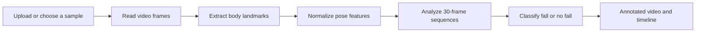

<div align="center">

<h1>Aether</h1>

### Video-based fall detection, made reviewable.

Upload footage. Analyze movement. Review the evidence.


[](LICENSE)

[Overview](#overview) · [How it works](#how-it-works) · [Run locally](#run-locally) · [Using Aether](#using-aether) · [Limitations](#limitations)

</div>

---

## Overview

**Aether is a fall-detection prototype for recorded video.** It extracts human body landmarks, analyzes their movement across consecutive frames, and flags motion that the model classifies as a potential fall. The result is an annotated video, a detection summary, and a timestamped timeline that a person can review.

The project addresses a practical problem: manually reviewing footage is slow, and a single image cannot explain how a movement developed. Aether combines pose estimation with sequence-based classification to turn a video into a more useful review workflow.

It is suitable for computer-vision demonstrations, academic presentations, and experimentation with temporal motion analysis. It is not a validated emergency-response system or a guarantee that a scene is safe.

## What the application does

- **Accepts uploaded video:** choose a file or drag it into the input panel. MP4 is recommended.
- **Includes four sample clips:** each card uses a frame from its actual video and a descriptive scenario name.
- **Analyzes motion:** MediaPipe pose landmarks feed a TensorFlow Lite classifier through a sliding sequence window.
- **Returns annotated footage:** body landmarks, frame predictions, and fall alerts appear on the output video.
- **Plays results automatically:** the analyzed video starts muted and loops, with Stop Video / Play Video controls.
- **Explains the result:** the summary shows the detected outcome and peak model confidence; the timeline shows video times and readable observations.
- **Exports a text summary:** Download Results saves the available processing summary.
- **Supports presentations:** the information icon opens a project overview covering the problem, pipeline, technologies, demonstration steps, and limitations.

Analysis starts only when **Analyze Video** is clicked. Selecting a sample does not start inference, and the loading indicator remains hidden while idle.

## How it works



### 1. Read the footage

OpenCV decodes the input video and reads its frame rate. Frames are processed sequentially. The implementation uses a fallback of 25 FPS if the input reports an invalid frame rate.

### 2. Extract and normalize the pose

MediaPipe Pose detects body landmarks. Aether selects **17 landmarks**, sorts them into the training feature order, and records three values per landmark:

- Horizontal position, **x**
- Vertical position, **y**
- Landmark visibility

This produces **51 features per frame**. Coordinates are centered around the hips and, when suitable reference landmarks are visible, scaled by the vertical shoulder-to-hip distance. Missing poses produce zero-valued feature vectors.

### 3. Classify a motion sequence

The app buffers **30 consecutive frames** and passes each complete sliding window to the bundled `fall_detection_transformer.tflite` model. Its expected input shape is **`(1, 30, 51)`**.

The model returns a fall probability. A value of **0.90 or greater** is classified as a fall; lower values are classified as no fall. Predictions begin only after the first full window. A 30-frame window is frame-based, so its duration in seconds depends on the video's frame rate.

### 4. Generate reviewable output

OpenCV draws the pose and prediction overlays. FFmpeg converts the result to an H.264 MP4 with browser-compatible pixel formatting. The dashboard displays the result and builds a timeline from the returned status entries.

A **10-second cooldown** suppresses repeated fall-event messages. It does not stop frame-by-frame classification or periodic status reporting.

## Technology stack

| Layer | Technology | Purpose |
| --- | --- | --- |
| Dashboard | HTML, JavaScript, Tailwind CSS | Responsive interface, file selection, analysis requests, and playback controls |
| Server | Python, FastAPI, Uvicorn | Serve the dashboard, receive uploads, and expose analysis endpoints |
| Video processing | OpenCV | Read frames, draw annotations, and create output video |
| Pose estimation | MediaPipe Pose | Extract human body landmarks |
| Feature processing | NumPy | Normalize landmarks and construct model input tensors |
| Inference | TensorFlow Lite through TensorFlow CPU | Execute the bundled Transformer model |
| Video encoding | FFmpeg | Convert annotated footage to browser-playable H.264 MP4 |
| Alternate interface | Gradio | Provide a secondary interactive interface at `/api` |
| Research | Jupyter notebooks | Explore LSTM, bidirectional LSTM, and Transformer training approaches |
| Packaging | Docker | Provide a container deployment starting point |

**The current dashboard does not require Node.js, npm, or a React build.** The repository also contains a React/Vite starter scaffold, but the running application serves the HTML/JavaScript dashboard directly.

## Run locally

### Requirements

- Git
- **Python 3.12** recommended; the local smoke test used Python 3.12.3 on Ubuntu Linux
- FFmpeg, available on your `PATH`, with the `libx264` encoder
- A modern browser
- Internet access for dependency installation and MediaPipe's first-use pose-model download

The application runs inference on the CPU; a dedicated GPU is not required. Use short clips initially: processing time and memory consumption increase with video length and resolution.

### 1. Clone the repository

```bash
git clone https://github.com/tony19053000/Aether.git
cd Aether
```

Run the remaining commands from this directory. The model and sample videos are included in the repository.

### 2. Install operating-system dependencies

**Ubuntu / Debian**

```bash
sudo apt update
sudo apt install -y python3-venv python3-pip ffmpeg libgl1 libglib2.0-0
```

Check that your Python interpreter is version 3.12 before continuing. If your system default differs, use `python3.12` in place of `python3` below.

**macOS**

Install Python 3.12 and FFmpeg using your preferred package manager. With Homebrew:

```bash
brew install python@3.12 ffmpeg
```

Use `python3.12` for environment creation. macOS has not been tested in this project setup; TensorFlow and MediaPipe wheel availability depends on the operating system and processor architecture.

**Windows**

Install 64-bit Python 3.12 and FFmpeg, and make sure both are accessible from a new terminal. Verify FFmpeg with `ffmpeg -version`.

### 3. Create a virtual environment

**Linux / macOS**

```bash
python3 -m venv .venv
source .venv/bin/activate
```

**Windows PowerShell**

```powershell
py -3.12 -m venv .venv
.\.venv\Scripts\Activate.ps1
```

If PowerShell blocks activation, use `.\.venv\Scripts\python.exe` directly in place of `python` in the following commands. There is no need to change your system execution policy.

### 4. Install compatible Python packages

```bash
python -m pip install --upgrade pip
python -m pip install -r requirements.txt "mediapipe==0.10.21" "tensorflow-cpu==2.19.1" "numpy==1.26.4" "opencv-python-headless==4.11.0.86" "opencv-contrib-python==4.11.0.86" "gradio==6.30.0"
```

These versions match the key packages used in the working local environment. MediaPipe is pinned because the code uses `mp.solutions.pose`; TensorFlow is pinned to retain the interpreter API used by this implementation. The OpenCV packages are kept on the same version, since MediaPipe installs the contrib distribution as a dependency.

Other dependencies are resolved from `requirements.txt`. This is a tested set of key versions, **not a complete dependency lockfile**. Installation on Windows and macOS has not been verified.

### 5. Start the server

```bash
python app.py
```

Wait for the Uvicorn startup message, then open **[http://127.0.0.1:7860](http://127.0.0.1:7860)**.

Keep the terminal running while using the app. Press **Ctrl+C** to stop the server. The first analysis may take longer while MediaPipe downloads its lightweight pose model.

Use this direct Python command for the current dashboard. The older `start.sh` script still attempts to build the unused React scaffold and is not the recommended startup path.

### Optional: use another port

**Linux / macOS**

```bash
PORT=7861 python app.py
```

**Windows PowerShell**

```powershell
$env:PORT = "7861"
python app.py
```

Then open `http://127.0.0.1:7861`.

The server currently binds to `0.0.0.0`, so it may be reachable from other devices on your network depending on firewall settings. The app has no login or access-control layer; the documented setup is intended for local development.

## Using Aether

1. **Choose a video.** Upload your own file or select a sample card.
2. **Start analysis.** Click Analyze Video. The output panel shows progress while the server processes the clip.
3. **Watch the result.** The annotated video starts automatically and loops. Stop Video pauses it and returns it to the beginning; Play Video restarts it. Native playback controls are also available.
4. **Review the summary and timeline.** Inspect the outcome, timestamps, observations, and confidence values.
5. **Save the summary.** Download Results exports the returned text log.
6. **Start again.** Reset clears the current selection and results from the interface.

Click the **ⓘ information icon** in the header for a presentation-friendly explanation. The overview closes with its cross button or the Escape key.

### Included sample scenarios

| Sample | Scenario | What the clip shows |
| --- | --- | --- |
| 1 | Warehouse Carrying Fall | A person falls while carrying a box in a warehouse |
| 2 | Gym Walking Fall | A person falls while walking beside gym equipment |
| 3 | Fall from a Chair | A person falls from a seated position in a gym |
| 4 | Indoor Walking · No Fall | A person walks and turns indoors without falling |

These labels describe the footage. They are not a benchmark, a guarantee of model predictions, or evidence of general accuracy.

## Understanding the results

**Fall detected** means a displayed prediction crossed the configured threshold. **No fall detected** means no fall prediction appears in the returned entries; it is not a safety guarantee.

**Confidence** is a model score for the reported class. For a fall prediction, the app displays the fall probability. For a no-fall prediction, it displays `1 − fall_probability`. Because the fall threshold is 0.90, a no-fall classification can still have a low displayed no-fall confidence.

**Peak model confidence** is the highest score among the displayed predictions for the reported outcome. It is not average confidence, calibrated certainty, or overall model accuracy.

**The timeline and downloaded summary retain only the latest 15 status entries.** Earlier events can be omitted, and the dashboard's overall outcome is derived from those returned entries. The output video retains the annotations across the processed clip. Review the video when evaluating a longer recording.

## Runtime settings

| Setting | Default | Meaning |
| --- | --- | --- |
| `PORT` | `7860` | Server port; supplied through the environment |
| `MODEL_PATH` | `fall_detection_transformer.tflite` | Model file resolved from the working directory |
| `INPUT_TIMESTEPS` | `30` | Frames per inference window |
| `FALL_CONFIDENCE_THRESHOLD` | `0.90` | Minimum fall probability for a fall classification |
| `FALL_EVENT_COOLDOWN` | `10` seconds | Minimum interval between logged fall-event alerts |
| `pose_complexity` | `0` | Lightweight MediaPipe pose model |

Except for `PORT`, these are constants in `app.py`, not environment variables or dashboard settings. Changing the sequence length requires a model with a matching input shape. If you change the threshold, also update its dashboard label and project description.

## Application endpoints

| Method | Path | Purpose |
| --- | --- | --- |
| GET | `/` | Main dashboard |
| POST | `/analyze` | Multipart video upload; the field name is `video` |
| GET | `/results/{filename}` | Generated browser-playable video |
| GET | `/videos/fall_example_{1..4}.mp4` | Bundled sample video |
| GET | `/thumbnails/{filename}` | Sample preview image |
| GET | `/api` | Alternate Gradio interface |
| GET | `/docs` | FastAPI's generated API documentation |

Example request from the repository directory:

```bash
curl -X POST http://127.0.0.1:7860/analyze \
  -F "video=@fall_example_1.mp4"
```

The response contains `video_url`, `summary`, `events`, and `elapsed`. Each event includes the raw description, video time in seconds, confidence when available, and a fall flag. `elapsed` is processing time in seconds, not the source video's duration.

## Data handling and deployment

Video inference runs on the server where you launch Aether. In the documented local setup, that is your own machine; analysis does not require a hosted inference API.

The dashboard upload endpoint stages input files in a temporary directory and removes them after processing. Converted result videos remain in temporary storage for playback. That storage is designed to be cleaned up when the server exits normally, so result URLs are not permanent. Reset clears the browser interface; it does not immediately delete server-side output files. Gradio manages its own temporary files separately.

Tailwind CSS and fonts load from external services. Internet access is therefore needed for the current page's full styling, as well as initial package/model downloads.

A Dockerfile is included and installs Python dependencies, FFmpeg, and system libraries. Its dependency installation currently follows the broad `requirements.txt` ranges rather than the tested version overrides above. The container path has not been validated in this setup; align its dependencies before relying on it for deployment.

## Troubleshooting

| Symptom | What to check |
| --- | --- |
| Browser says “connection refused” | Ensure `python app.py` is still running and has printed its startup message. Check the selected port and try `127.0.0.1` instead of `localhost`. |
| `ensurepip` is unavailable when creating the environment | On Ubuntu/Debian, install the virtual-environment package for your Python version, such as `python3.12-venv`. |
| `mediapipe` has no attribute `solutions` | Reinstall the pinned MediaPipe version inside the active virtual environment. |
| Model not found or model fails to load | Start from the repository root, confirm the bundled `.tflite` file is present, and use the compatible TensorFlow version above. |
| First analysis fails while downloading a pose model | Check internet access and retry. MediaPipe downloads its lightweight pose asset on first use. |
| Output conversion fails | Run `ffmpeg -version` and confirm the FFmpeg build supports `libx264`. |
| Upload cannot be decoded | Try a short, valid MP4 that plays in a local video player. |
| Page looks unstyled or icons are missing | Check whether the Tailwind CDN and Google Fonts requests are blocked. |
| Browser does not autoplay the result | Click Play Video; browser playback policies may require interaction. |
| Long clips are slow or exhaust memory | Reduce duration or resolution. The current pipeline retains annotated frames in memory before encoding. |
| Port is already in use | Stop the existing server or choose another `PORT`. |

## Validation and limitations

A local smoke test on Ubuntu with Python 3.12.3 processed all **272 frames** of the first sample and produced a readable annotated video. The model flagged a fall at approximately **4.2 seconds**. Browser checks also exercised sample selection, analysis, result playback, looping, Stop/Play, Reset, and the project overview.

These checks establish that the workflow ran for the tested inputs. They do not establish clinical validity, general accuracy, or production reliability.

Current limitations include:

- Uploaded videos only; no live camera, RTSP ingestion, or notification delivery.
- Single-person pose analysis; no multi-person identity tracking.
- Possible missed detections and false positives, especially with occlusion, poor lighting, unusual viewpoints, or unfamiliar motion.
- Frame-rate-dependent temporal windows and no explicit recovery of missing pose estimates.
- Truncated status history and memory usage that grows with the processed video.
- No authentication, durable event database, or production job queue.
- No published, reproducible evaluation of the bundled model on a separate deployment test set in this README.

## Training and future work

The repository includes experimental notebooks for LSTM, bidirectional LSTM, and Transformer classifiers, plus pose-extraction and sequence-preparation utilities. The training datasets are not bundled. Some notebook dataset paths refer to Kaggle environments, and the 60-frame experiments are separate from the deployed 30-frame model.

Before retraining or replacing the model, verify landmark mapping, feature ordering, normalization, sequence length, and dataset splits against the inference implementation. The original extraction utility and runtime landmark mapping need reconciliation for reproducible training.

Useful next steps are complete event history, streaming output encoding, reproducible dependency locking, broader model evaluation, and—after validation—live input and alert integration.

## License and attribution

Source code is distributed under the [MIT License](LICENSE). The existing copyright notice credits **Payut Charoensri (2025)** and must be preserved in copies and substantial portions of the software.

Aether is a customized adaptation of earlier work. The source-code license does not establish ownership or redistribution rights for every bundled third-party media asset. Some sample footage contains visible stock-media watermarks; review the relevant rights before redistributing or using those clips commercially.
